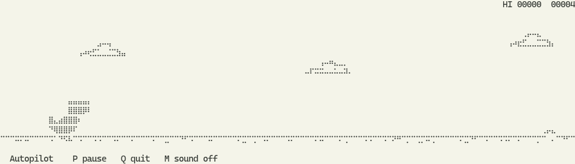

<!-- project:start -->
# TermRex

The Chromium offline dinosaur, in your terminal. A small native Rust executable turns the original desert sprites into Unicode Braille dots. The playable website runs the same simulation and pixel renderer through WebAssembly.

**[Play the live demo](https://seiya058904.github.io/TermRex/)** · [Download](#run-locally) · [Controls](#controls)
<!-- project:end -->

<p align="center">
  <a href="https://seiya058904.github.io/TermRex/"></a>
</p>
<p align="center">
  
  
  <a href="https://github.com/seiya058904/TermRex/actions/workflows/pages.yml"></a>
  <a href="LICENSE"></a>
</p>

The recording samples the live Windows console character buffer and renders its cells in Cascadia Mono. In the browser, select **Play demo** to take over from the autopilot.

## Run locally

Choose a portable binary and run the command in its download folder. The game works offline and needs no game engine, package manager or separate runtime. Open a UTF-8 terminal with a Braille-capable monospace font, at least **81 columns × 14 rows**. More columns preserve finer sprite detail.

| Platform | Binary | Run |
| --- | --- | --- |
| Windows x64 | [termrex.exe](https://seiya058904.github.io/TermRex/downloads/termrex.exe) | `.\termrex.exe` |
| Linux x64 (glibc, Ubuntu 22.04 or newer equivalent) | [termrex-linux-x64](https://seiya058904.github.io/TermRex/downloads/termrex-linux-x64) | `chmod +x termrex-linux-x64 && ./termrex-linux-x64` |
| macOS Apple silicon | [termrex-macos-arm64](https://seiya058904.github.io/TermRex/downloads/termrex-macos-arm64) | `chmod +x termrex-macos-arm64 && ./termrex-macos-arm64` |
| macOS Intel | [termrex-macos-x64](https://seiya058904.github.io/TermRex/downloads/termrex-macos-x64) | `chmod +x termrex-macos-x64 && ./termrex-macos-x64` |

The downloads are unsigned. Every Pages deployment builds its binaries from the same commit as the demo and publishes [SHA-256 checksums](https://seiya058904.github.io/TermRex/downloads/SHA256SUMS.txt).

With Rust 1.89 or newer, install directly from source:

```sh
cargo install --locked --git https://github.com/seiya058904/TermRex
termrex
```

## Controls

| Key | Action |
| --- | --- |
| Space, ↑, W | Start or jump. Release early for a shorter arc. |
| ↓, S | Duck while grounded. Press in the air to dive. |
| P | Pause or resume. |
| R | Start a fresh run. |
| M | Toggle the milestone bell. Use `--mute` to start silently. |
| Q, Ctrl+C | Return to the shell. |

**Key release.** Windows uses native console key events. On macOS and Linux, terminals implementing the kitty keyboard protocol can report press, repeat and release. On a press-only terminal, Space gives a short jump and ↑ or W gives a full jump. Repeated down events renew a short duck timeout. The system repeat delay can briefly interrupt a long duck on those terminals.

## Inside the runner

- **Pixel rendering.** The original 1× sprite sheet supplies the idle blink, two running and ducking poses, jump, crash, grouped cacti, three flight heights, clouds, two terrain strips and seven moon phases. A 600 × 150 logical frame is projected onto the available 2 × 4 dot cells.
- **Movement.** A fixed 60 Hz tick starts at 6 px per tick, accelerates by 0.001 and caps at 13. Jump velocity starts at −10 with Chromium’s speed adjustment. Gravity is 0.6, early release caps upward velocity at −5, and a dive uses the 3× displacement multiplier. Overlapping head, body and leg boxes handle close passes.
- **Distance.** Every 100 points flashes the score three times. Each 700-point boundary starts a fading night lasting about 200 displayed points. Birds enter the obstacle pool at speed 8.5.
- **Terminal lifecycle.** Each frame batches changed rows into one write. Resizing below the minimum freezes the simulation. Dropping the screen and input guards restores the shell on return, an I/O error or Rust panic unwinding.
- **Local records.** Native high scores use a locked, atomically replaced file at `%LOCALAPPDATA%\termrex\best` or `$XDG_STATE_HOME/termrex/best` (default `~/.local/state/termrex/best`). Browser scores stay in that browser. Autopilot runs use a separate, unsaved score.

## Development

```sh
cargo test --locked
cargo run --release -- --demo
cargo run --release -- --benchmark
```

The benchmark drives real keyboard actions through the game simulation and paints to an interactive terminal until 1001 points. It reports loop FPS, 99th-percentile and maximum frame intervals, and missed deadlines. Font rendering and display refresh depend on the terminal host.

To serve the site locally, install the Rust `wasm32-unknown-unknown` target, run `cargo build --release --lib --target wasm32-unknown-unknown`, copy `target/wasm32-unknown-unknown/release/termrex_core.wasm` to `web/termrex.wasm`, and run `python -m http.server --directory web`. The deployment workflow stages the four platform downloads.

## Credits

TermRex is an independent port of the Chromium offline runner. The visual atlas and adapted geometry and movement come from Chromium **90.0.4430.212**. The pinned resources are [offline.js](https://github.com/chromium/chromium/blob/90.0.4430.212/components/neterror/resources/offline.js) and the [1× sprite sheet](https://github.com/chromium/chromium/blob/90.0.4430.212/components/neterror/resources/images/default_100_percent/offline/100-offline-sprite.png).

Original project code uses the [BSD 3-Clause license](LICENSE). Chromium material retains its [upstream notice](assets/LICENSE.chromium). Run `termrex --license` for both notices.
